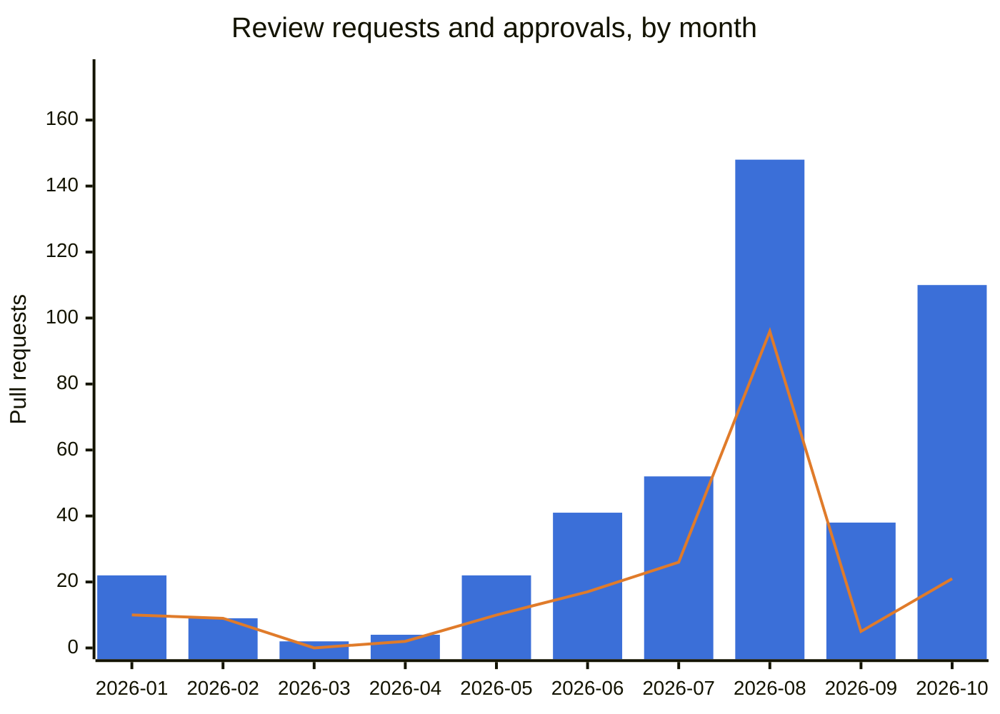
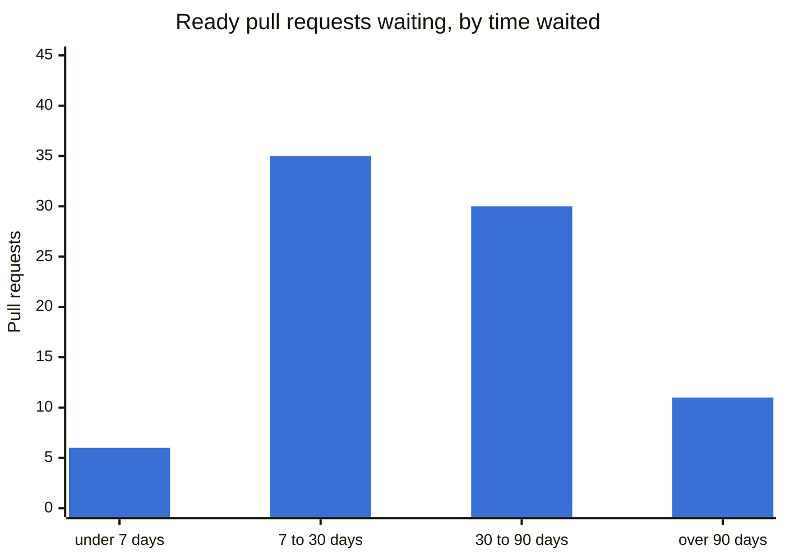

# Project activity

Generated 2026-10-30 by `tools/project-activity.sh`, from the GitHub API, over the pull requests opened since 2025-10-30. No person is named here; the numbers are counts. What each one counts is at the end, under [How this is counted](#how-this-is-counted).

## Summary

Each line is one question about the project, with a light: 🟢 fine, 🟡 watch, 🔴 needs people. What each light means by the numbers is under [How this is counted](#how-this-is-counted).

- 🔴 **Review does not keep up with what arrives.** Of the 279 `xymon` pull requests that became ready for review since June, 144 were approved (52%).
- 🔴 **Pull requests wait a long time.** 41 of the 82 now waiting for an approval have waited more than a month.
- 🟡 **Review rests on few people.** 4 people do 80% of the reviewing; the busiest does 33% of it.
- 🟢 **No code is merged without a review.** Since 2026-09-13, when `CONTRIBUTING.md` wrote the review rule down, no code changes were merged in `xymon` without an approval.
- 🟡 **Few new contributors arrive.** 2 of the 6 people who opened a pull request in the last three months were new.

## Help wanted

Review is the project's bottleneck, and everyone is welcome to help fill the gap — no membership is needed to review a pull request or to open one.

| | Value |
|---|---|
| Review requests arriving in `xymon` in a typical month (median of the last four whole months) | 46.5 |
| Approvals one active reviewer gives in a month (median, same months) | 4 |
| Reviewers active in a month (median, same months) | 4.5 |
| Reviewers needed to keep up (estimate) | 12 — about 8 missing |
| Pull request authors in the last three months / of them new | 6 / 2 |

The estimate divides the arrivals by one reviewer's pace; it is a range read from a few months, not a target.

How to help:

- **Review** one of the pull requests waiting longest, listed under [Waiting for review](#waiting-for-review): read it, try it if you can, and approve it or say what is wrong. A review from someone who runs Xymon in production is worth as much as one from a developer.
- **Contribute**: pick an issue and open a pull request — [First contribution](../contributing/git/first-contribution.md) says how.
- **Talk to us** on the mailing list, linked from [Project & community](project-and-community.md).

## Review in `xymon`

Bars: pull requests that became ready for review. Line: approvals. The gap between them is review that did not happen.

| Month | Became ready | Approved | Merged | Merged without an approval: allowed | needing a review | Reviews | Reviewers |
|---|---|---|---|---|---|---|---|
| 2026-01 | 22 | 10 | 10 | 0 | 0 | 14 | 4 |
| 2026-02 | 9 | 9 | 8 | 0 | 0 | 28 | 4 |
| 2026-03 | 2 | 0 | 0 | 0 | 0 | 0 | 0 |
| 2026-04 | 4 | 2 | 2 | 0 | 0 | 2 | 2 |
| 2026-05 | 22 | 10 | 9 | 0 | 0 | 14 | 2 |
| 2026-06 | 41 | 17 | 17 | 2 | 1 | 31 | 6 |
| 2026-07 | 52 | 26 | 30 | 0 | 0 | 30 | 5 |
| 2026-08 | 148 | 96 | 108 | 12 | 0 | 111 | 4 |
| 2026-09 | 38 | 5 | 14 | 9 | 0 | 5 | 4 |
| 2026-10 | 110 | 21 | 87 | 66 | 0 | 29 | 3 |

Each column counts by its own date: became ready, approved and reviewed in that month, or merged in that month; months before the first pull request in the window are left out. **Reviews** counts every review, approving or not. **Allowed** is what the merge table lets a maintainer merge without a review, as [How this is counted](#how-this-is-counted) says; **needing a review** is code merged without one. The summary counts from 2026-09-13, the day `CONTRIBUTING.md` wrote the review rule down; the column classifies every month the same way.

Reviews submitted, by reviewer; each column is one person.

| Reviewer | #1 | #2 | #3 | #4 | #5 | #6 | #7 | #8 | #9 | #10 |
|---|---|---|---|---|---|---|---|---|---|---|
| Reviews | 87 | 56 | 51 | 33 | 30 | 3 | 1 | 1 | 1 | 1 |

## Waiting for review

| Measure | Value |
|---|---|
| Waiting now | 82 |
| Waiting: median / mean / longest | 33.9 days / 50 days / 154.3 days |
| More than 30 / 90 days | 41 / 11 |

Waiting longest, oldest first — a reviewer is welcome on any of them:

- [xymon#111](https://github.com/xymon-monitoring/xymon/pull/111) — build: drop the make-era platform targets nobody builds (#85) (154.3 days)
- [xymon#135](https://github.com/xymon-monitoring/xymon/pull/135) — build: make SNMP a configure option like RRD, SSL and LDAP, still off by default (151.6 days)
- [xymon#150](https://github.com/xymon-monitoring/xymon/pull/150) — xymon-snmpcollect: stop polling the next IP when an agent answers NOSUCHNAME (141.4 days)
- [xymon#151](https://github.com/xymon-monitoring/xymon/pull/151) — svcstatus: stop the trends-page locator redirect loop with SKIPLOC (TBT 44) (141.3 days)
- [xymon#152](https://github.com/xymon-monitoring/xymon/pull/152) — do_rrd: remember an RRD exists instead of stat()ing it every update (TBT 214, devel f106d8840) (141.3 days)

## Pull requests by repository

Only `xymon` asks for a review before a merge; the other repositories take direct pushes and pull requests their authors merge themselves, so a merge without an approval there is the normal way. **Open** counts every open pull request, drafts and approved ones included, which is why it is more than the number waiting for review.

| Repository | Opened | Merged | Merged with an approval | Merged without | Closed unmerged | Open |
|---|---|---|---|---|---|---|
| `xymon` | 465 | 285 | 195 | 90 | 79 | 101 |
| `xymon-rpm` | 100 | 94 | 0 | 94 | 3 | 3 |
| `xymon-wiki` | 30 | 29 | 0 | 29 | 0 | 1 |
| `homebrew-xymon` | 20 | 20 | 0 | 20 | 0 | 0 |
| `xymon-experimental` | 18 | 18 | 0 | 18 | 0 | 0 |

3 smaller repositories with fewer than 10 pull requests are left out: `xymon-client-windows-powershell`, `xymon-discussion-public`, `xymon-plugins`.

## How this is counted

**Waiting for review** means ready (not a draft), still open, and without an approval from someone other than its author; it is measured from the first time the pull request was ready. A **review** is a GitHub review by someone other than the author; a plain comment is not one.

A merge without an approval is **allowed** or **needing a review** by the files the pull request touches; a pull request with no file list is classified by its title's component instead:

| Counted as | When every file is | May merge without a review |
|---|---|---|
| documentation | under `docs/`, a manual page, a `.md` file, a configuration sample, `README*`, `RELEASENOTES`, `CREDITS` or `Changes` | yes — `CONTRIBUTING.md`'s merge table |
| build, CI, tests | documentation, or under `build/`, `tests/`, `tools/` or `.github/`, or `configure` | yes — the same table |
| AIX, Solaris and macOS clients | the above, or `client/xymonclient-aix.sh`, `client/xymonclient-darwin.sh`, `client/xymonclient-sunos.sh`, `xymond/client/aix.c`, `xymond/client/darwin.c`, `xymond/client/solaris.c` | counted as yes by this page until the first release that ships them, since nobody but their author can run them yet; not a project rule |
| comment | a code file whose changed lines are all comment lines | yes — the merge table's "typo, comment" row |
| code | anything else | no |

The summary's lights are this page's own thresholds, chosen to make a change visible; they are not project rules:

| Line | 🟢 when | 🔴 when |
|---|---|---|
| review keeps up | ≥ 90% of what became ready in the last four whole months was approved | < 60% |
| pull requests wait | ≤ 5 have waited more than 30 days | > 20 |
| review rests on few people | ≥ 6 people do 80% of the reviews | ≤ 3 |
| code merged without a review | none since the rule was written down | ≥ 1 |
| new contributors | ≥ 3 in the last three months | none |

**Not counted**: discussion on the mailing list and in chat; reviews given as plain comments; an owner's administrative work; changes pushed without a pull request, which is how most wiki pages are written.
