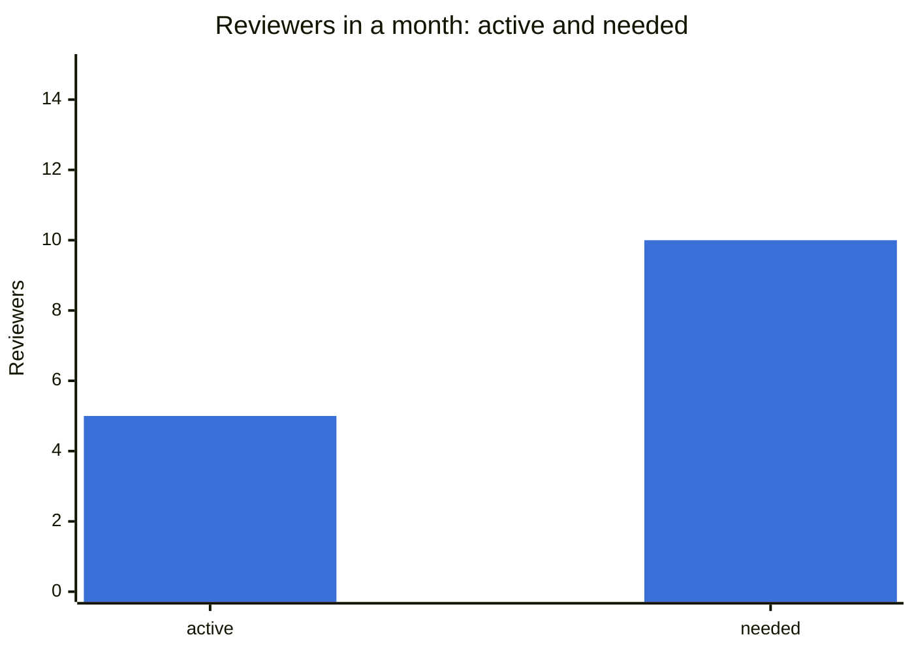
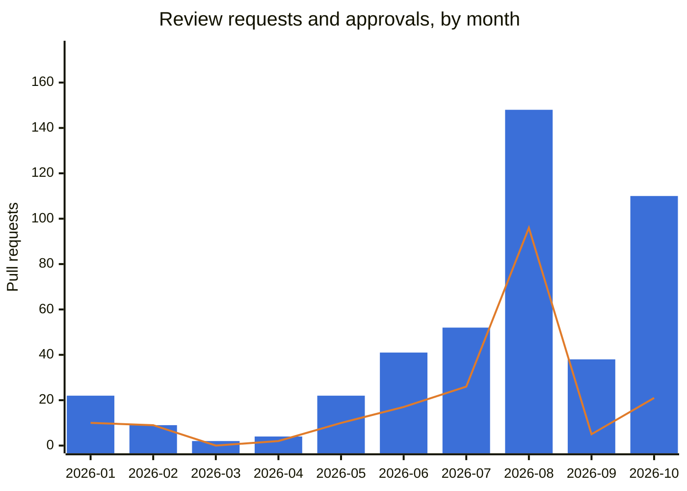
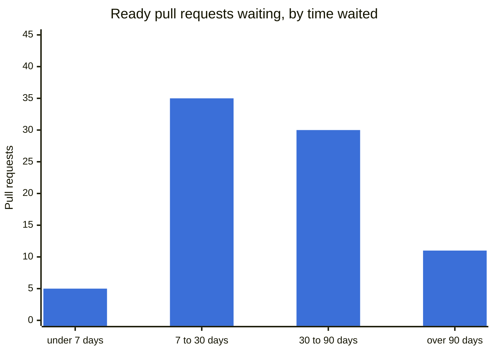

# Project activity

Generated 2026-10-29 by `tools/project-activity.sh`, from the GitHub API. Window: pull requests opened since 2025-10-29, in the organisation's public repositories. No person is named here; the numbers are counts.

**Waiting for review** means ready (not a draft), still open, and without an approval from someone other than its author; it is measured from the first time the pull request was ready. A **review** is a GitHub review by someone other than the author; a plain comment is not one.

## Help wanted

Review is the project's bottleneck, and everyone is welcome to help fill the gap — no membership is needed to review a pull request or to open one.

| | Value |
|---|---|
| Review requests arriving in `xymon` (median of the last four whole months) | 52 a month |
| Approvals one active reviewer gives in a month (median, same months) | 5.2 |
| Reviewers active in a month (median, same months) | 5 |
| Reviewers needed to keep up (estimate) | 10 — about 5 missing |
| Pull request authors in the last three months / of them new | 6 / 2 |

How to help:

- **Review** one of the pull requests waiting longest, listed under [Waiting for review](#waiting-for-review): read it, try it if you can, and approve it or say what is wrong. A review from someone who runs Xymon in production is worth as much as one from a developer.
- **Contribute**: pick an issue and open a pull request — [First contribution](../contributing/git/first-contribution.md) says how.
- **Talk to us** on the mailing list, linked from [Project & community](project-and-community.md).

The estimate divides the arrivals by one reviewer's pace; it is a range read from a few months, not a target.

## Summary

| | Question | Value | 🟢 when | 🔴 when |
|---|---|---|---|---|
| 🔴 | Does review keep up with what arrives? (`xymon`, last four whole months) | 279 became ready · 144 approved (52%) | ≥ 90% approved | < 60% |
| 🔴 | Ready pull requests waiting more than 30 days | 41 of 81 waiting | ≤ 5 | > 20 |
| 🟡 | People doing 80% of the reviews | 4 (busiest: 33% of all reviews) | ≥ 6 | ≤ 3 |
| 🔴 | Code merged in `xymon` without an approval since the review rule (2026-09-13) | 4 | 0 | ≥ 1 |
| 🟡 | New pull request authors in the last three months | 2 (of 6 authors) | ≥ 3 | 0 |

The thresholds are this page's own, chosen to make a change visible; they are not project rules.

## Pull requests by repository

Only `xymon` asks for a review before a merge; the other repositories are pushed to directly, so a merge without an approval there is the normal way.

| Repository | Opened | Merged | Merged with an approval | Merged without | Merged by their own author | Closed unmerged | Open |
|---|---|---|---|---|---|---|---|
| `xymon` | 465 | 285 | 195 | 90 | 212 | 79 | 101 |
| `xymon-rpm` | 100 | 94 | 0 | 94 | 92 | 3 | 3 |
| `xymon-wiki` | 29 | 29 | 0 | 29 | 29 | 0 | 0 |
| `homebrew-xymon` | 20 | 20 | 0 | 20 | 20 | 0 | 0 |
| `xymon-experimental` | 18 | 18 | 0 | 18 | 18 | 0 | 0 |
| `xymon-discussion-public` | 4 | 4 | 0 | 4 | 4 | 0 | 0 |
| `xymon-plugins` | 3 | 2 | 0 | 2 | 0 | 0 | 1 |
| `xymon-client-windows-powershell` | 2 | 1 | 0 | 1 | 1 | 0 | 1 |

## Review in `xymon`

Bars: pull requests that became ready for review. Line: approvals. The gap between them is review that did not happen.

| Month | Became ready | Approved | Merged | Merged without an approval: allowed | needing a review | Reviews | Reviewers |
|---|---|---|---|---|---|---|---|
| 2026-01 | 22 | 10 | 10 | 0 | 0 | 14 | 4 |
| 2026-02 | 9 | 9 | 8 | 0 | 0 | 28 | 4 |
| 2026-03 | 2 | 0 | 0 | 0 | 0 | 0 | 0 |
| 2026-04 | 4 | 2 | 2 | 0 | 0 | 2 | 2 |
| 2026-05 | 22 | 10 | 9 | 0 | 0 | 14 | 2 |
| 2026-06 | 41 | 17 | 17 | 1 | 2 | 31 | 6 |
| 2026-07 | 52 | 26 | 30 | 0 | 0 | 30 | 5 |
| 2026-08 | 148 | 96 | 108 | 8 | 4 | 111 | 4 |
| 2026-09 | 38 | 5 | 14 | 9 | 0 | 5 | 4 |
| 2026-10 | 110 | 21 | 87 | 62 | 4 | 29 | 3 |

Over the whole window, 195 of 285 merges had an approval (68%); of the rest, 80 were documentation, build, CI or test changes, which `CONTRIBUTING.md`'s merge table lets a maintainer merge without a review, and 10 were code, which needs one. Classification by title: a title starting `docs:`, a manual page, a configuration file, a `.md` file, `README:`, `RELEASING:`, `CONTRIBUTING:`, `AGENTS:`, `RELEASENOTES:`, `CREDITS:` or `Changes:` counts as documentation; `build:`, `ci:`, `tests:` or `tools:` as build, CI and tests; anything else as code.

Reviews submitted, by reviewer; each column is one person.

| Reviewer | #1 | #2 | #3 | #4 | #5 | #6 | #7 | #8 | #9 | #10 |
|---|---|---|---|---|---|---|---|---|---|---|
| Reviews | 87 | 56 | 51 | 33 | 30 | 3 | 1 | 1 | 1 | 1 |

## Waiting for review

| Measure | Value |
|---|---|
| Waiting now | 81 |
| Waiting: median / mean / longest | 36.9 days / 49.5 days / 153.3 days |
| More than 30 / 90 days | 41 / 11 |

Waiting longest, oldest first — a reviewer is welcome on any of them:

- [xymon#111](https://github.com/xymon-monitoring/xymon/pull/111) — build: drop the make-era platform targets nobody builds (#85) (153.3 days)
- [xymon#135](https://github.com/xymon-monitoring/xymon/pull/135) — build: make SNMP a configure option like RRD, SSL and LDAP, still off by default (150.5 days)
- [xymon#150](https://github.com/xymon-monitoring/xymon/pull/150) — xymon-snmpcollect: stop polling the next IP when an agent answers NOSUCHNAME (140.3 days)
- [xymon#151](https://github.com/xymon-monitoring/xymon/pull/151) — svcstatus: stop the trends-page locator redirect loop with SKIPLOC (TBT 44) (140.3 days)
- [xymon#152](https://github.com/xymon-monitoring/xymon/pull/152) — do_rrd: remember an RRD exists instead of stat()ing it every update (TBT 214, devel f106d8840) (140.2 days)

## Not counted

Discussion on the mailing list and in chat; reviews given as plain comments; an owner's administrative work; changes pushed without a pull request, which is how most wiki pages are written.
